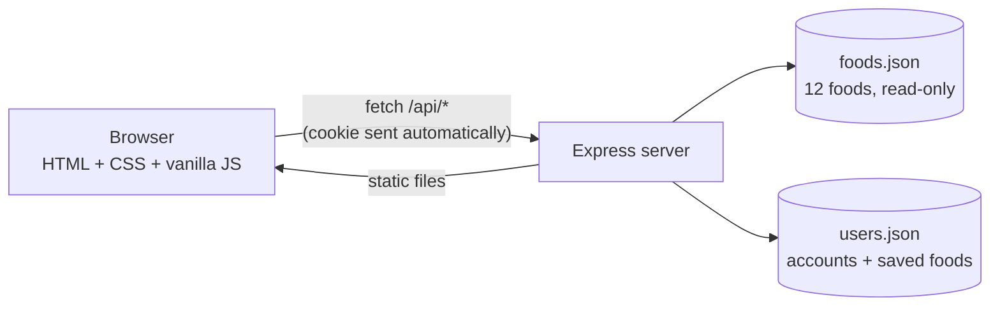
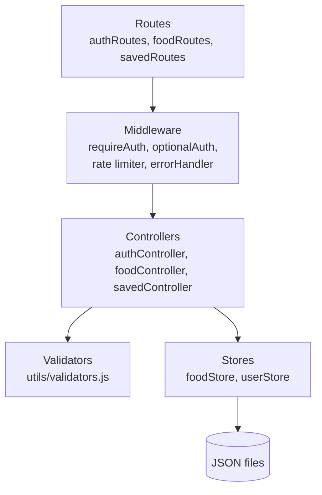
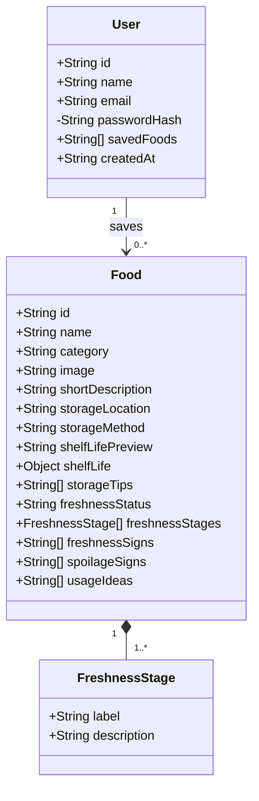
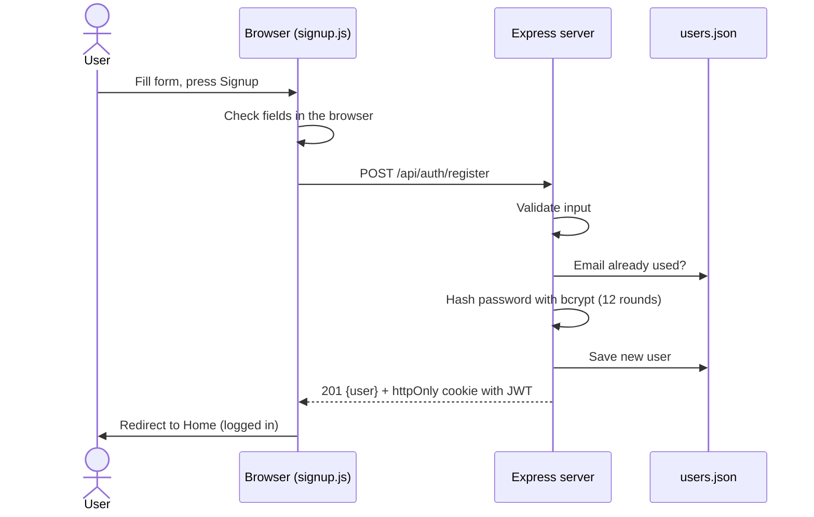
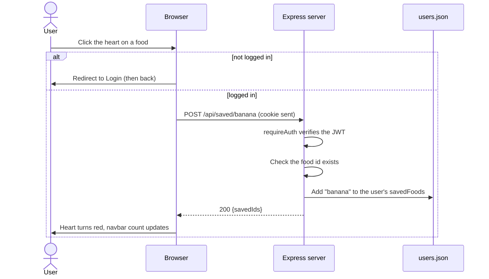
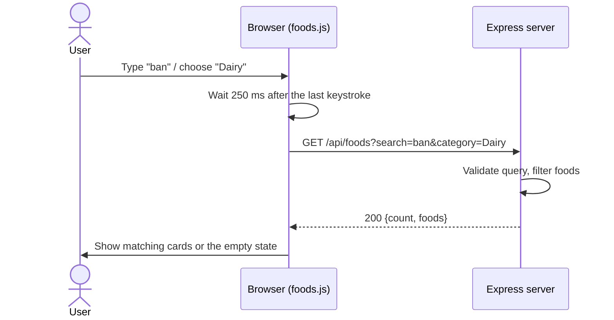

# ShelfLife: Project Status

A food shelf-life guide with user accounts. This document describes everything about the project as it stands, so it can be used to prepare UML diagrams, slides and reports.

---

## 1. Overview

**ShelfLife** helps people understand how long everyday foods generally last, where to store them, how to recognise freshness and spoilage, and how to use food before it goes to waste. Registered users can save foods to their own list.

| | |
| --- | --- |
| Type | College mini-project (full-stack web application) |
| Main SDG | **SDG 12**: Responsible Consumption and Production |
| Supporting SDG | **SDG 2**: Zero Hunger |
| Core feature | Estimated shelf-life information for each food, per storage condition |

**Problem:** good food is thrown away because people are unsure how long it lasts or how to store it.
**Solution:** a simple website with clear shelf-life estimates, storage advice, freshness stages, warning signs and "use it up" ideas.

---

## 2. Technology stack

| Layer | Technology |
| --- | --- |
| Frontend | Plain HTML, CSS, vanilla JavaScript (ES modules). No framework, no build step |
| Backend | Node.js (v20+), Express 5 |
| Data storage | JSON files (`foods.json` for foods, `users.json` for accounts and saved foods) |
| Password security | bcryptjs (12 rounds) |
| Sessions | JSON Web Token (JWT) in an httpOnly cookie |
| Security middleware | Helmet (security headers), express-rate-limit, cookie-parser |
| Configuration | dotenv (`.env` file for secrets) |
| Testing | Node's built-in test runner + supertest |

---

## 3. What the application does (features)

**Visitors (no login):**
- Browse all 12 foods with images, storage-location label, freshness status and a shelf-life preview.
- Search foods by name and filter by category (both work together).
- Open a food's details page: estimated shelf life per storage condition, storage method and tips, freshness stages, freshness signs, spoilage signs, and use-it ideas.
- Read the Recipes / Use It page (6 ideas for using food before it is wasted) and the About page.

**Registered users (after login):**
- Sign up, log in and log out.
- Save and unsave foods. The list is stored per user on the server and is available from any browser after login.
- See saved foods on the **Saved Foods** page, with a count badge in the navbar.

**Rules:**
- Saving a food while logged out sends the visitor to the login page, then back to where they were.
- Shelf-life values are always presented as general estimates. The details page shows a disclaimer that separates food *quality* from food *safety*.

---

## 4. System architecture

The browser talks to one Express server. Express serves the static frontend files and the JSON API on the same address (`http://localhost:3000`).



### Server layers



Request flow: **route → middleware → controller → validation → store → JSON response**. Any error is passed to one central error handler that always returns `{ "message": "...", "errors": { ... } }`.

---

## 5. Project structure

```
ShelfLife/
├── client/                      Frontend (served as static files)
│   ├── index.html               Home
│   ├── foods.html               Explore Foods
│   ├── food.html                Food details (uses ?id=banana)
│   ├── recipes.html             Recipes / Use It
│   ├── saved.html               Saved Foods
│   ├── login.html, signup.html  Account pages
│   ├── about.html, 404.html
│   ├── css/style.css            All styling
│   ├── images/                  Food photos + placeholder
│   └── js/
│       ├── api.js               fetch wrapper (talks to the API)
│       ├── session.js           Current user + saved ids
│       ├── layout.js            Navbar and footer for every page
│       ├── ui.js                Card / badge / button HTML helpers
│       ├── constants.js         Categories, labels, disclaimer text
│       ├── recipes-data.js      The 6 use-it ideas
│       ├── auth-form.js         Shared login/signup form helpers
│       └── pages/               One script per page
├── server/                      Backend
│   ├── server.js                Starts the server
│   ├── app.js                   Builds the Express app
│   ├── routes/                  URL to controller mapping
│   ├── controllers/             Request handling logic
│   ├── middleware/              Auth + error handling
│   ├── store/                   foodStore.js, userStore.js (data access)
│   ├── data/foods.json          The food dataset
│   ├── utils/                   Validators, AppError
│   └── tests/                   API tests
├── .env.example                 Template for secrets (real .env is never committed)
├── package.json
└── README.md
```

---

## 6. Data model

### Food (from `foods.json`)

| Field | Type | Notes |
| --- | --- | --- |
| id (slug) | string | e.g. `banana`, used in URLs |
| name | string | |
| category | string | Fruits, Vegetables, Dairy, Pantry & Grains |
| image | string | Path to photo |
| shortDescription | string | |
| storageLocation | string | Refrigerator, Pantry, Room Temperature |
| storageMethod | string | |
| shelfLifePreview | string | Short text shown on cards |
| shelfLife | object | Optional keys: roomTemperature, refrigerator, pantry, freezer (only relevant ones present) |
| storageTips | string[] | |
| freshnessStatus | string | Highly Perishable, Moderately Perishable, Longer Lasting |
| freshnessStages | {label, description}[] | Differs per food |
| freshnessSigns | string[] | |
| spoilageSigns | string[] | |
| usageIdeas | string[] | |

### User (in `users.json`)

| Field | Type | Notes |
| --- | --- | --- |
| id | string (UUID) | |
| name | string | 2–50 characters |
| email | string | Unique, stored lowercase |
| passwordHash | string | bcrypt hash, never returned by the API |
| savedFoods | string[] | List of food ids, e.g. `["banana", "milk"]` |
| createdAt | ISO date string | |



### The 12 foods

| Food | Category | Best storage | Freshness status | Shelf-life preview |
| --- | --- | --- | --- | --- |
| Banana | Fruits | Room Temperature | Highly Perishable | about 3–5 days |
| Apple | Fruits | Refrigerator | Longer Lasting | about 4 weeks |
| Strawberry | Fruits | Refrigerator | Highly Perishable | about 3–5 days |
| Tomato | Vegetables | Room Temperature | Moderately Perishable | about 2–3 days once ripe |
| Potato | Vegetables | Pantry | Longer Lasting | about 3–4 weeks |
| Spinach | Vegetables | Refrigerator | Highly Perishable | about 5 days |
| Milk | Dairy | Refrigerator | Highly Perishable | about 5–7 days once opened |
| Yogurt | Dairy | Refrigerator | Moderately Perishable | about 5–7 days once opened |
| Cheese | Dairy | Refrigerator | Longer Lasting | about 3–4 weeks (hard cheese) |
| Bread | Pantry & Grains | Room Temperature | Moderately Perishable | about 4–5 days |
| Rice | Pantry & Grains | Pantry | Longer Lasting | dry: about 1 year, cooked: 3–4 days |
| Pasta | Pantry & Grains | Pantry | Longer Lasting | dry: about 2 years, cooked: 3–4 days |

---

## 7. API reference

Base address: `http://localhost:3000`. All bodies are JSON.

| Method | Route | Login needed | Purpose | Success | Errors |
| --- | --- | --- | --- | --- | --- |
| GET | `/api/foods?search=&category=` | No | List foods, optionally filtered | 200 `{count, foods}` | 400 invalid query |
| GET | `/api/foods/:id` | No | One food | 200 `{food}` | 400 bad id, 404 not found |
| POST | `/api/auth/register` | No | Create account and log in | 201 `{user}` | 400 validation, 409 email taken |
| POST | `/api/auth/login` | No | Log in | 200 `{user}` | 400 validation, 401 wrong credentials |
| POST | `/api/auth/logout` | No | Log out (clears cookie) | 200 | |
| GET | `/api/auth/me` | No | Current user, or `{user: null}` | 200 | |
| GET | `/api/saved` | **Yes** | The user's saved foods | 200 `{count, foods}` | 401 |
| POST | `/api/saved/:id` | **Yes** | Save a food (repeat is harmless) | 200 `{message, savedIds}` | 400, 401, 404 |
| DELETE | `/api/saved/:id` | **Yes** | Remove a saved food | 200 `{message, savedIds}` | 400, 401, 404 |

Every error response has the same shape: `{ "message": "...", "errors": { "field": "..." } }` (`errors` only when field-specific).

### Validation rules

| Input | Rule |
| --- | --- |
| Name | Text, 2–50 characters |
| Email | Valid format, up to 254 characters, case-insensitive and unique |
| Password | 8–72 characters, at least one letter and one number |
| Search | Text, up to 50 characters |
| Category | Must be one of the four categories |
| Food id | Lowercase letters, digits and hyphens only (up to 40 characters) |

---

## 8. Key flows (sequence diagrams)

### Register and login



### Save a food



### Search and filter foods



---

## 9. Use cases

| # | Actor | Use case |
| --- | --- | --- |
| 1 | Visitor, User | Browse foods |
| 2 | Visitor, User | Search foods by name |
| 3 | Visitor, User | Filter foods by category |
| 4 | Visitor, User | View a food's shelf life, storage, freshness and spoilage details |
| 5 | Visitor, User | Read use-it ideas and the About page |
| 6 | Visitor | Register an account |
| 7 | Visitor | Log in |
| 8 | User | Log out |
| 9 | User | Save a food |
| 10 | User | Remove a saved food |
| 11 | User | View Saved Foods |

Actors: **Visitor** (not logged in) and **User** (logged in). A User can do everything a Visitor can.

---

## 10. Pages (frontend routes)

| URL | Page | Notes |
| --- | --- | --- |
| `/` | Home | Hero, 4 featured foods, feature overview |
| `/foods` | Explore Foods | Search box, category chips, food cards |
| `/food?id=banana` | Food details | Full shelf-life and storage information |
| `/recipes` | Recipes / Use It | 6 idea cards |
| `/saved` | Saved Foods | Needs login; shows saved cards with Remove button |
| `/login` | Login | Email and password |
| `/signup` | Signup | Name, email, password, confirm password |
| `/about` | About | Purpose and why storage awareness matters |
| any other | 404 page | Links back to Home and Explore Foods |

The design is responsive (laptop, tablet, mobile) with a warm cream, espresso, sage-green and tomato-red palette.

---

## 11. Security measures

- Passwords are hashed with **bcrypt** (12 rounds). Plain passwords are never stored or returned.
- Login uses a **JWT in an httpOnly, SameSite=Lax cookie** (valid 7 days; Secure flag on in production). JavaScript on the page cannot read it, so no token appears in frontend code.
- Wrong email and wrong password give the **same error message**, and the server does equal work either way, so attackers cannot tell which emails have accounts.
- **Rate limiting:** 20 login or register attempts per IP every 15 minutes.
- **Helmet** adds security headers, including a Content Security Policy.
- Requests over 10 KB are rejected, and all input is validated by type and format.
- The browser escapes all text before putting it into the page (protection against script injection).
- The `next` redirect after login only accepts paths on the same site.
- Secrets (`JWT_SECRET`) live in `.env`, which is never committed. `.env.example` is the template.
- `users.json` is git-ignored and readable only by its owner.

---

## 12. Testing

- **31 automated API tests** (`npm test`) covering:
  - foods: list, search, category, combined filters, not found, bad ids
  - auth: register, login, logout, duplicates, weak passwords, operator-injection input, tampered cookies
  - saved foods: login required, add, remove, no duplicates, separate lists per user, persistence after logout
  - the JSON store: saving to disk, surviving a restart, concurrent duplicate sign-ups, refusing a damaged file
  Tests use a temporary users file and never touch real data.
- **Browser checks** were run during development on desktop, tablet and mobile widths: search and filters, navigation, signup and login, save and remove, persistence across browsers, layout without horizontal scrolling, no broken images, no console errors. (That script is not part of the repository.)

---

## 13. How to run

```bash
npm install
cp .env.example .env     # then set JWT_SECRET to a long random string
npm start                # open http://localhost:3000
```

`npm run dev` restarts the server on file changes. `npm test` runs the tests.

---

## 14. Design decisions

- **One server, one address.** Express serves both the pages and the API, so no cross-site (CORS) setup is needed and cookies work simply.
- **Vanilla JavaScript, multi-page site.** Each page has its own HTML file and script; shared code (navbar, footer, API calls) is in small modules.
- **File-based storage instead of a database.** Simple to run and explain for a college project, with nothing extra to install. The stores (`foodStore.js`, `userStore.js`) hide how data is kept, so a database could replace them later without changing controllers or the frontend.
- **Server-side saved foods** so a user's list follows them across browsers and devices.
- **Cautious wording.** Shelf-life values are presented as approximate estimates, never as expiry dates or safety guarantees.

---

## 15. Current status

**Completed**
- Food API with search and category filter
- Registration, login, logout with hashed passwords and cookie sessions
- Per-user saved foods (add, remove, list)
- Input validation and consistent error handling
- Full responsive frontend in plain HTML, CSS and JavaScript
- Automated API tests

**Known limitations**
- Data is stored in one JSON file that is rewritten on each change. This suits a demo or a few users, not heavy use.
- No password reset, email verification or account deletion.
- Recipes ideas and the category list are fixed data in the frontend, not served by the API.
- The rate limiter keeps its counts in memory, so they reset when the server restarts.
- Shelf-life figures are general estimates written for this project and should be checked against an authoritative source before being relied on.
- Food photos come from Wikimedia Commons. Individual licences were not recorded.

**Intentionally not included:** AI or machine-learning features, barcode scanning, automatic expiry prediction, notifications or reminders, an admin dashboard, payments, and user image uploads.

**Possible future work:** move storage to a real database, add password reset, per-item purchase dates and reminders, more foods, and moving recipes into the API.
