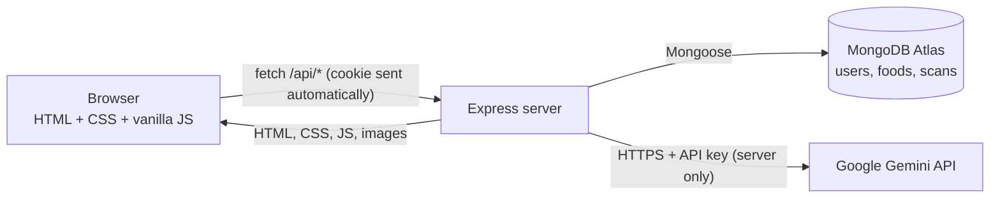
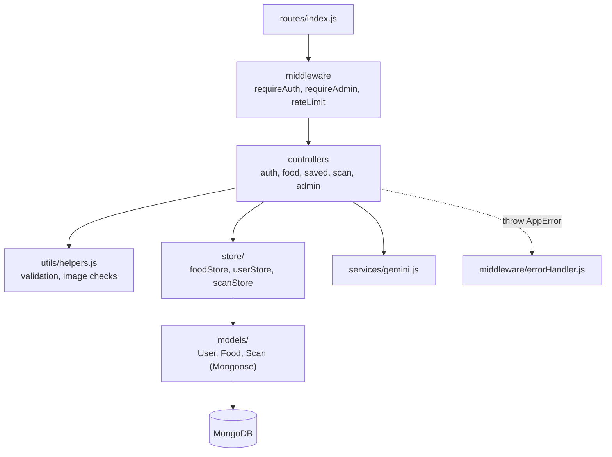
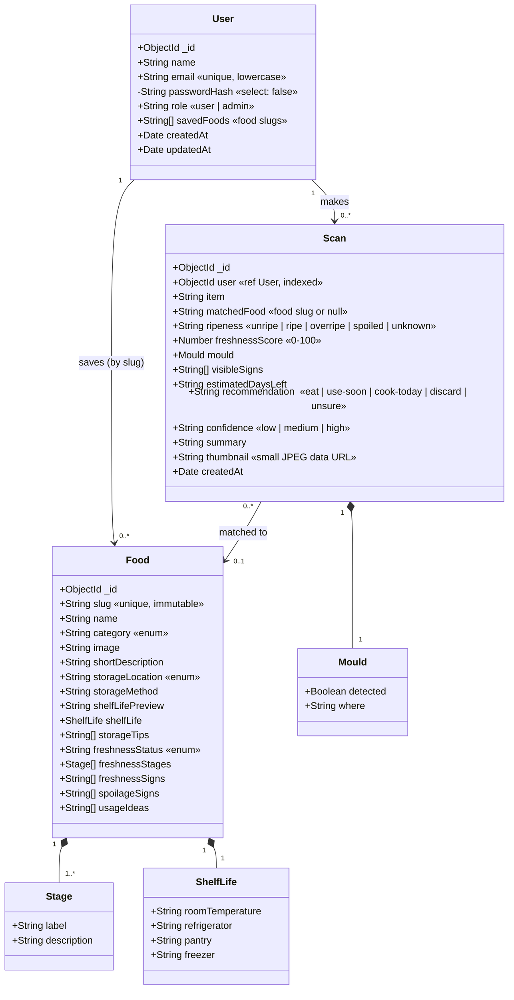
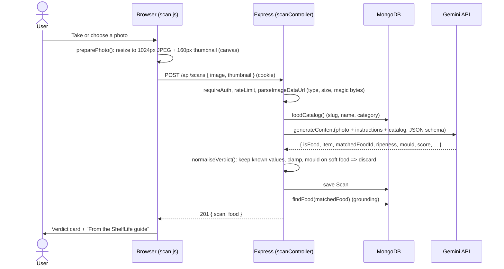
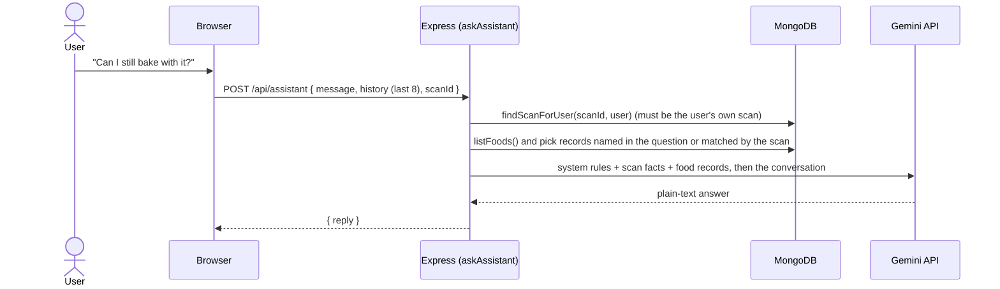
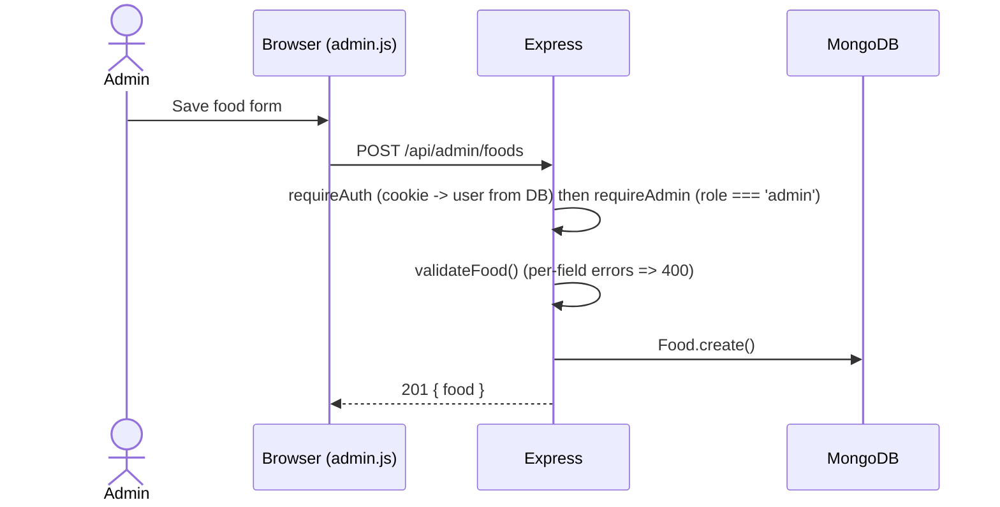

# ShelfLife 2.0: Project Reference

Everything about the project as it stands, for UML diagrams, slides, the report and the viva.
For a guided explanation of the code, see [`docs/VIVA_NOTES.md`](docs/VIVA_NOTES.md).

---

## 1. Overview

**ShelfLife** helps households waste less food. People photograph fruit or vegetables and get an
instant freshness reading, look up how long foods keep and how to store them, and find ways to use
food up before it spoils.

| | |
| --- | --- |
| Type | College mini-project (full-stack web application) |
| Main SDG | **SDG 12**: Responsible Consumption and Production (target 12.3: halve food waste) |
| Supporting SDG | **SDG 2**: Zero Hunger |
| Headline feature | AI freshness scanner grounded in our own food database |

**Problem.** About 1.05 billion tonnes of food were wasted in 2022, 60% of it in households
(UNEP Food Waste Index Report 2024). Much is thrown out because people are unsure whether it is still good.
**Solution.** A scanner that gives one clear call (eat / use soon / cook today / throw out), a storage guide, and use-it-up ideas.

### What changed since the mid-semester evaluation

| Feedback / goal | What we built |
| --- | --- |
| Add an admin page | Role-based **admin console**: overview charts, food CRUD with photo upload, user role management, scan log |
| Landing page photos were misleading | **Product-led landing page**: the hero is a live demo of the scanner reading a photo; produce photos appear only as scanner input or as reference in the guide, never as decoration |
| Add an AI chatbot | **Freshness scanner chat**: upload/take a photo → structured verdict (ripeness, mould, score, days left, recommendation) → follow-up questions |
| Real database | **MongoDB Atlas** with Mongoose schemas replaces the JSON files |
| Overall quality | New visual identity, accessibility, rate limiting, NoSQL-injection protection, 39 API tests + 22 browser tests |
| Frontend level-up (v3/v4) | "Second look" brand identity (colour-blocked ink, ivory, tomato, citrus, orange and botanical green; Archivo + Instrument Sans; the scanner lens as the motif), scanner rebuilt as an instrument with visible states, a cinematic **interactive fridge** for saved foods, food guide grown from 12 to **50 foods** with one consistent studio photo style |

---

## 2. Technology stack

| Layer | Technology | Why |
| --- | --- | --- |
| Frontend | HTML, CSS, vanilla JavaScript (ES modules) | No build step; every line is readable and explainable |
| Backend | Node.js 20+, Express 5 | Express 5 forwards errors from async handlers to the error handler automatically |
| Database | MongoDB Atlas (free M0) + Mongoose 9 | Documents match our data (a food has nested lists); schemas give validation |
| AI | Google Gemini `generateContent` REST API (free tier) | Vision + structured JSON output; free; called with native `fetch`, no SDK |
| Passwords | bcryptjs, 12 rounds | Slow, salted hashing |
| Sessions | JWT in an httpOnly, SameSite=Lax cookie | Page JavaScript can never read the token |
| Security headers | Helmet (incl. Content Security Policy) | |
| Tests | `node:test` + mongodb-memory-server; Playwright | Real database and real browser, no internet or AI quota needed |

Runtime dependencies: `express`, `mongoose`, `bcryptjs`, `jsonwebtoken`, `cookie-parser`, `helmet`, `dotenv`.
Dev dependencies: `mongodb-memory-server`, `@playwright/test`.

---

## 3. Features

**Visitors**
- Landing page: headline with the scanner's input photo set inside it, an animated example reading, how a scan works (3 steps), a ripeness spectrum of real banana photos with a slider that reads the stages of any food from the guide, an editorial food-guide spread, what a reading gives you, closing call to action.
- Food guide (50 foods): search by name + filter by category (combined), storage, shelf life and perishability per food.
- Food details: shelf life per storage condition (best one marked), stages coloured along the ripeness scale, storage method and tips, fresh vs spoilage signs, use-it ideas, quality-vs-safety disclaimer.
- Use it up (recipe ideas, served by the API) and About.

**Logged-in users**
- Freshness scanner: an instrument panel with visible states (idle, preparing, analysing, done, error with retry), camera or file upload, drag-and-drop, paste; verdict card (observations, recommendation and guide advice in separate sections); follow-up questions; suggested questions.
- Save / unsave foods; saved foods shown in an **interactive fridge** (doors open, foods on shelves by category, hover/focus label, detail panel with the food's guide data and the user's latest scan of it, remove with confirm and undo); scan history tab (clearable).

**Admins**
- Overview: account/food/scan/save totals, scans per day (14 days), scanner recommendations, most-saved foods.
- Foods: add / edit / delete (deleting also removes it from every user's saved list), photo upload.
- Users: search, make admin / remove admin, delete (cannot demote or delete yourself).
- Scans: the 50 most recent scans across all users.

---

## 4. Architecture

### Server layers

Request flow: **route → middleware → controller → validation → store → model → JSON response**. Any thrown
error reaches one error handler that always answers `{ "message": "...", "errors": { ... } }`.

---

## 5. Data model (MongoDB collections)

Enumerations: categories = Fruits, Vegetables, Dairy, Pantry & Grains; storage = Room Temperature, Refrigerator, Pantry;
freshness status = Highly Perishable, Moderately Perishable, Longer Lasting.

**Why saved foods are stored as slugs on the user** (embedding) rather than a separate collection: a user saves a
handful of foods, we always read them together with the user, and `$addToSet` / `$pull` update them atomically.

---

## 6. API reference

Base address `http://localhost:3000`. JSON in and out. Errors: `{ "message", "errors"? }`.

| Method | Route | Access | Purpose | Success |
| --- | --- | --- | --- | --- |
| GET | `/api/health` | Public | Server up? Is the AI configured? | `{ ok, ai }` |
| GET | `/api/foods?search=&category=` | Public | List / search / filter foods | `{ count, foods }` |
| GET | `/api/foods/:id` | Public | One food by slug | `{ food }` |
| GET | `/api/meta` | Public | Categories and recipe ideas | `{ categories, recipes }` |
| POST | `/api/auth/register` | Public, rate-limited | Create account + log in | 201 `{ user }` + cookie |
| POST | `/api/auth/login` | Public, rate-limited | Log in | `{ user }` + cookie |
| POST | `/api/auth/logout` | Public | Clear cookie | `{ message }` |
| GET | `/api/auth/me` | Public | Current user or `null` | `{ user }` |
| GET | `/api/saved` | User | Saved foods | `{ count, foods }` |
| POST | `/api/saved/:id` | User | Save (repeat is harmless) | `{ message, savedIds }` |
| DELETE | `/api/saved/:id` | User | Unsave | `{ message, savedIds }` |
| POST | `/api/scans` | User, rate-limited | Analyse a photo `{ image, thumbnail? }` | 201 `{ scan, food }`, or 200 `{ scan: null, message }` if not food |
| GET | `/api/scans` | User | My last 30 scans | `{ count, scans }` |
| DELETE | `/api/scans` | User | Clear my scan history | `{ message }` |
| POST | `/api/assistant` | User, rate-limited | Ask `{ message, history?, scanId? }` | `{ reply }` |
| GET | `/api/admin/stats` | Admin | Totals and chart data | `{ totals, scansByRecommendation, scansPerDay, mostSaved }` |
| POST | `/api/admin/foods` | Admin | Create food | 201 `{ food }` |
| PUT | `/api/admin/foods/:id` | Admin | Update food (slug cannot change) | `{ food }` |
| DELETE | `/api/admin/foods/:id` | Admin | Delete food (+ remove from saved lists) | `{ message }` |
| POST | `/api/admin/images` | Admin | Upload a food photo `{ image }` | 201 `{ path }` |
| GET | `/api/admin/users` | Admin | All users | `{ count, users }` |
| PATCH | `/api/admin/users/:id` | Admin | Set role `{ role }` | `{ user }` |
| DELETE | `/api/admin/users/:id` | Admin | Delete user and their scans | `{ message }` |
| GET | `/api/admin/scans` | Admin | 50 most recent scans | `{ count, scans }` |

Status codes used: 400 validation, 401 not logged in, 403 not admin, 404 not found, 409 duplicate,
413 too large, 422 AI could not answer, 429 rate limit / AI quota, 502/503/504 AI service problems.

**Rate limits:** register + login 20 per 15 minutes per IP; scans + assistant 6 per minute per user.

### Validation rules

| Input | Rule |
| --- | --- |
| Name | 2–50 characters |
| Email | valid format, ≤ 254 characters, unique (case-insensitive) |
| Password | 8–72 characters, at least one letter and one number |
| Search / category | ≤ 50 characters / one of the four categories |
| Food id (slug) | `a-z`, `0-9`, `-`, ≤ 40 characters |
| Food (admin) | every field checked by `validateFood()`: lengths, enums, 1–12 list items, 1–8 stages, image path inside `/images/` |
| Photo | JPEG/PNG/WebP data URL, ≤ 2.5 MB, and the file's first bytes must really be that image type |
| Assistant message | 1–500 characters; at most 10 earlier turns are used |

---

## 7. Key flows

### Freshness scan

### Follow-up question (grounded chat)

### Admin request

Register/login, save-a-food and search flows are unchanged from version 1 except that data now lives in MongoDB.

---

## 8. Use cases

| # | Actor | Use case |
| --- | --- | --- |
| 1 | Visitor, User | Browse, search and filter the food guide |
| 2 | Visitor, User | View a food's shelf life, storage, stages and signs |
| 3 | Visitor, User | Read use-it-up ideas and About |
| 4 | Visitor | Register, log in |
| 5 | User | Log out |
| 6 | User | Save / unsave foods, view saved foods |
| 7 | User | Scan a photo and get a freshness verdict |
| 8 | User | Ask the assistant follow-up questions |
| 9 | User | View / clear scan history |
| 10 | Admin | View overview statistics |
| 11 | Admin | Add, edit, delete foods (upload photos) |
| 12 | Admin | Promote / demote / delete users |
| 13 | Admin | View recent scans |
| — | Gemini API (external system) | Analyses photos and answers questions for 7 and 8 |

An Admin can do everything a User can; a User everything a Visitor can.

---

## 9. Pages

| URL | Page | Script |
| --- | --- | --- |
| `/` | Home: hero scanner demo, how a scan works, ripeness spectrum + stage reader, guide spread, features, call to action | `pages/home.js` |
| `/scan` | Freshness scanner: instrument stage + readings and chat | `pages/scan.js` |
| `/foods` | Food guide | `pages/foods.js` |
| `/food?id=banana` | Food details | `pages/food.js` |
| `/recipes` | Use it up | `pages/recipes.js` |
| `/saved` | Saved foods (the fridge) and scan history tabs | `pages/saved.js` |
| `/admin` | Admin console (role-gated) | `pages/admin.js` |
| `/login`, `/signup` | Accounts | `pages/login.js`, `pages/signup.js` |
| `/about` | About, how the scanner works, limits | `pages/about.js` |
| anything else | 404 | `pages/notfound.js` |

### Visual design

"Second look" identity (v4): ShelfLife is the moment you look at food again before deciding.
Colour blocks of deep ink `#111310`, warm ivory `#F5F0E6`, tomato red `#DF4328`, citrus yellow `#F4C13D`, rich orange
`#EC7B2C` and botanical green `#1F5A3A`; each section uses one block so neighbouring sections never look alike. Type:
**Archivo** (expanded, heavy display headings) and **Instrument Sans** (text, labels, numbers). The motif is the scanner
**lens** (a circle with reticle marks), used only where something is being looked at (the hero, the scanner, About, auth).
Buttons are pills; panels are crisp. The **ripeness scale** (green → yellow → amber → brown) is reserved for freshness data.
Food photos are real, licensed photographs, all processed the same way: cut out, centred at the same scale on an 800×800
square with the same soft shadow, and shown on one shared warm studio background (`.food-frame`), so the 50 foods read as
one series (credits in `docs/PHOTO_CREDITS.md`). A second, tightly cropped set (`client/images/fridge/`) lets foods stand on the
fridge shelves. All colours, sizes, spacing and motion values are tokens in
`client/css/tokens.css`. Responsive from 360px, keyboard accessible, and `prefers-reduced-motion` turns animations off.
The fridge (`client/css/fridge.css`) is built from layered HTML with CSS 3D transforms, gradients for steel, glass and LED light,
and `backdrop-filter` for the frosted crisper drawer; no 3D library.

---

## 10. Security

| Threat | Protection | Where |
| --- | --- | --- |
| Stolen passwords | bcrypt, 12 rounds; hash never returned (`select: false`) | `authController.js`, `models/User.js` |
| Token theft by scripts (XSS) | JWT only in an httpOnly cookie | `middleware/auth.js` |
| Script injection in pages | Every API value escaped with `escapeHtml()`; CSP allows only our own scripts, no inline scripts or styles | `client/js/ui.js`, `server/app.js` |
| CSRF | `SameSite=Lax` cookie; JSON-only API | `middleware/auth.js` |
| Account enumeration | Same error and same bcrypt work for unknown email and wrong password | `authController.js` |
| Password guessing | 20 login/register attempts per 15 min per IP → 429 | `middleware/rateLimit.js` |
| NoSQL injection (`{"$gt": ""}`) | Type checks in validators + Mongoose `sanitizeFilter` | `utils/helpers.js`, `db.js` |
| Regex injection in search | User text escaped before `new RegExp` | `store/foodStore.js` |
| Privilege escalation | Role re-read from the database on every request; `requireAdmin` on all `/api/admin` routes; admins cannot demote/delete themselves | `middleware/auth.js`, `routes/index.js` |
| Reading others' data | Scans looked up by id **and** owner | `store/scanStore.js` |
| Malicious uploads | Type whitelist, size limit, magic-byte check, server-chosen random file name | `utils/helpers.js`, `adminController.js` |
| Large-body DoS | 10 KB body limit, 4 MB only on the two upload routes | `app.js` |
| AI key leak | Key only in `.env` on the server, sent in a header, never to the browser | `services/gemini.js` |
| Trusting AI output | Enum whitelist, clamped numbers, trimmed text, our own mould rule | `scanController.js` |
| AI quota abuse | Login required + 6 requests/min per user | `routes/index.js` |
| Secrets in git | `.env` is git-ignored; `.env.example` is the template | `.gitignore` |

---

## 11. Testing

| Suite | Command | What it covers |
| --- | --- | --- |
| API (39 tests) | `npm test` | Gemini service (low thinking level, fallback model when busy, quota message, hidden thought parts); foods search/filter/regex safety; register/login/logout, duplicates, NoSQL injection, cookie flags; saved foods; scanner with fake AI (grounding, mould rule, cleaning bad AI output, non-food, fake image files, ownership); assistant context; admin 401/403, CRUD, validation, users, uploads; 404 JSON, body limit, security headers; rate limiting |
| Browser (11 journeys × desktop + mobile = 22) | `npm run test:e2e` | Home demo + stage reader (food picker and slider) + guide spread, guide search/filter/empty state (50 foods), save-while-logged-out redirect, fridge: save → item on shelf → detail panel → remove (two-step) → undo → reload, fridge keyboard (Enter opens, Escape returns focus) + empty state, full scanner journey with follow-ups and history, visitor gate, admin gate, admin add/edit/delete food, admin validation errors, mobile navigation without horizontal scroll |

Both suites use an in-memory MongoDB and a fake AI service, so they run offline and never spend Gemini quota.

### Scanner evaluation (real AI, `npm run eval`)

The tests prove the code paths, not whether the AI's answers are right. `scripts/evaluate-scanner.js` measures that.
It sends each labelled photo in `eval/labels.json` to the **real** scanner code (the same Gemini prompt and schema
in `services/gemini.js` and the same `normaliseVerdict()` safety rule in `scanController.js`) and compares the answer
with the label a person chose. It never writes to MongoDB, sends one photo every 12 seconds, stops after 3 failures in a
row, and `--resume` continues a run that ran out of quota. Results are saved in `eval/results.json`.

The set has 26 photos: 15 fresh, 3 overripe and 8 that must be thrown out (rotten or mouldy). They are older app photos
plus free-licensed Wikimedia Commons photos (credits in `labels.json`). Where two answers are both reasonable
(an overripe banana: "use soon" or "cook today") the label accepts both.

**First run, 2026-10-18** (`gemini-3.5-flash`, backup `gemini-3.5-flash-lite`). The free daily quota ran out after 20 photos,
so 6 of the 8 "must discard" photos are still to be scored.

| Measure | Result (20 photos) |
| --- | --- |
| Right food (matched to our catalogue) | 20 of 20 |
| Right ripeness stage | 20 of 20 |
| Right mould call | 19 of 19 scored |
| Right recommendation | 19 of 20 (95%) |
| "Must discard" photos the scanner also discarded | 2 of 2 |
| Usable photos wrongly told to discard | 0 of 18 |

The one miss: green (unripe) bananas got "use soon" instead of "eat". The recommendation list has no
"wait until ripe" option, so a future version could add one. Twenty photos is a rough indicator, not a benchmark.

---

## 12. Known limitations

- Scanner verdicts come from a general vision model; they can be wrong, especially for blurry photos or foods not in the guide. We show confidence and always frame results as quality, not safety.
- Gemini's free tier has rate limits: about 20 requests per day per model at the time of writing, and per-minute limits. When they run out the scanner asks people to try again later.
- The rate limiter stores counts in memory, so it resets on restart and would need a shared store (e.g. Redis) for several servers.
- Uploaded food photos are saved on the server's disk; a hosted deployment would use object storage.
- No password reset or email verification.
- Shelf-life figures are general estimates written for this project.
- Saved foods are bookmarks: the fridge shows what a user saved from the guide, not what is physically in their fridge, and the date a food was saved is not recorded.
- Food photos come from Wikimedia Commons / Openverse under CC0, public domain, CC BY or CC BY-SA licences; they must stay credited (`docs/PHOTO_CREDITS.md`, which lists the author and licence of each one).

## 13. Future work

Pantry tracker with purchase dates and "use first" reminders (the fridge could then show real inventory); more foods; installable PWA
so the camera opens straight from the home screen; finish the scanner evaluation and grow it to a larger labelled fresh/rotten set; a "wait until ripe" recommendation; deployment.
